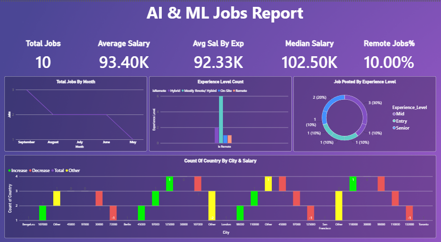

📊 AI & ML Jobs Analysis Dashboard | Power BI

📌 Project Overview

The AI & ML Jobs Analysis Dashboard is an interactive Power BI project designed to analyze job market trends in Artificial Intelligence and Machine Learning. It provides insights into salary distributions, job opportunities, experience levels, required skills, company hiring patterns, work modes, and geographical demand.

The dashboard helps job seekers, recruiters, and data analysts understand the current job landscape and identify in-demand skills, high-paying roles, and hiring trends across different companies and locations.

🎯 Project Objectives

Analyze job opportunities across AI and ML job roles.

Compare average, median, and experience-level salaries.

Identify the most frequently required technical skills.

Explore company-wise hiring patterns and job distributions.

Analyze job opportunities across countries, cities, and regions.

Understand the relationship between remote work, skills, and salary.

Compare job requirements across entry-level, mid-level, and senior positions.

🛠️ Tools & Technologies

Power BI – Interactive dashboards and data visualization

Power Query – Data cleaning and transformation

DAX – Measures, calculated metrics, and KPI calculations

Data Visualization – Charts, maps, tables, and interactive filters

📈 Dashboard Pages & Features

1.Overview Dashboard

Provides a high-level summary of the AI and ML job market through key performance indicators and visualizations.

Key Metrics:

- Total Jobs

- Average Salary

- Average Salary by Experience

- Median Salary

- Remote Jobs Percentage

Visualizations:

- Monthly job posting trends

- Experience-level distribution

- Job postings by experience level

- City-wise job and salary analysis

2.Company & Role Insights

Analyzes company-wise hiring activity and job role characteristics.

Key Features:

- Company-wise job distribution by experience level

- Job titles compared with total job counts and experience levels

- Company ratings versus average ratings

- Remote work ratio compared with average salary by job title

- Business Value: Helps identify hiring patterns across companies and compare job roles based on salary, experience requirements, and remote work opportunities.

3.Location Insights

Explores the geographical distribution of AI and ML job opportunities and salary differences across locations.

Key Features:

- Country-wise job distribution

- Country-wise job counts and average salary

- Geographical job distribution using map visualization

- Region-wise average salary by experience level

- Filters for region, experience level, and year-month

- Business Value: Helps identify geographical hiring hotspots and compare salary opportunities across countries and regions.

4.Skill & Hiring Insights

Focuses on technical skills, hiring requirements, and their relationship with salary and work mode.

Key Features:

- Skill usage by experience level

- Average skill requirements by experience level

- Job-wise average salary comparison

- Skill distribution by work mode

- Experience-level distribution of skill requirements

- Total distinct skill count

Business Value: Helps job seekers identify relevant technical skills and understand how skill requirements vary across experience levels and work arrangements.

🔍 Key Insights

Based on the dashboard visualizations:

- Salary analysis: The report compares average and median salaries to provide a broader understanding of compensation in AI and ML roles.

- Experience-level comparison: Entry-level, mid-level, and senior positions can be analyzed to understand salary differences and job distribution.

- Skill demand: Technical skills such as Python, SQL, Machine Learning, Deep Learning, Cloud Computing, NLP, and TensorFlow are included in the skill analysis.

- Geographical opportunities: The location report compares job availability and average salaries across countries, regions, and cities.

- Work flexibility: Remote, hybrid, and on-site job arrangements are analyzed to understand work-mode distribution.

- Company and role comparison: The dashboard allows users to explore differences in hiring activity, company ratings, and job characteristics.

Note: Findings are based on the dataset used in this project. The dashboard's results should not be interpreted as a complete representation of the entire AI and ML job market.

🖼️ Dashboard Preview

1. Overview Dashboard

  

2. Company & Role Insights

  

3. Location Insights

  

4. Skill & Hiring Insights

  

⚙️ How to Use the Project

1. Clone or download this repository.

2. Download and install Microsoft Power BI Desktop.

3. Open the .pbix file in Power BI Desktop.

4. If prompted, connect to or update the dataset source.

5. Refresh the data if required.

6. Use the interactive filters and visuals to explore job market trends.

💡 Skills Demonstrated

- Data Cleaning and Transformation

- Exploratory Data Analysis (EDA)

- Data Modeling

- DAX Measures and Calculations

- KPI Development

- Interactive Dashboard Design

- Salary and Job Market Analysis

- Geographic Data Visualization

- Business Intelligence and Data Storytelling

🚀 Future Improvements

* Add salary comparisons by specific skills and job titles.

* Analyze salary trends over time.

* Include additional job market datasets for broader comparisons.

* Develop more detailed remote-versus-on-site salary analysis.

* Add advanced filters for company, skills, country, and experience level.

⭐ If you find this project useful, consider giving the repository a star!